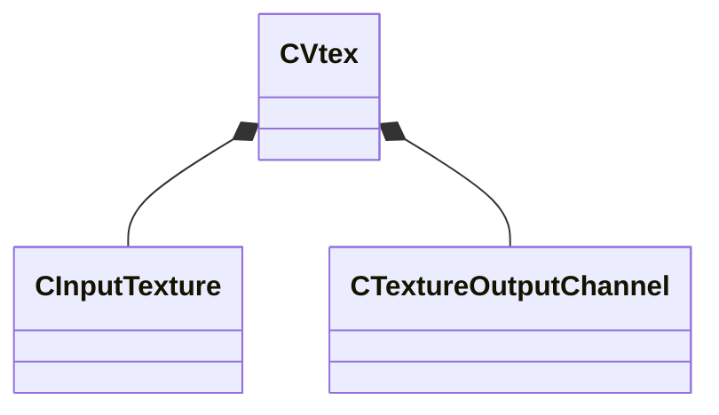

[Schemas](../../schemas.md) / [texturelib](../texturelib.md) / CVtex

# CVtex

> Source: **Build 26144732** · 2026-10-22 · `windows-x86_64` · schema `0.12.0`

**Kind:** class · **Size:** 128 bytes (`0x80`) · **Align:** 8 · **Module:** texturelib

**Relationships:**

## Memory layout

16 fields (16 declared here, 0 inherited). Offsets are absolute from the object base.

| Offset | Field | Type | From | Annotations |
|--------|-------|------|------|-------------|
| `0x0` | `m_inputTextureArray` | CUtlVector< [CInputTexture](../texturelib/CInputTexture.md) > |  |  |
| `0x18` | `m_outputTypeString` | CUtlString |  |  |
| `0x20` | `m_outputFormat` | CUtlString |  |  |
| `0x28` | `m_outputClearColor` | Vector4D |  |  |
| `0x38` | `m_nOutputMinDimension` | int32 |  |  |
| `0x3c` | `m_nOutputMaxDimension` | int32 |  |  |
| `0x40` | `m_nOutputDimensionReduce` | int32 |  |  |
| `0x48` | `m_textureOutputChannelArray` | CUtlVector< [CTextureOutputChannel](../texturelib/CTextureOutputChannel.md) > |  |  |
| `0x60` | `m_vClamp` | Vector |  |  |
| `0x6c` | `m_bNoLod` | bool |  |  |
| `0x6d` | `m_bHiddenAssetFlag` | bool |  |  |
| `0x6e` | `m_bNormalizeRange` | bool |  |  |
| `0x6f` | `m_bVirtualTexture` | bool |  |  |
| `0x70` | `m_nDisplayRectWidth` | int32 |  |  |
| `0x74` | `m_nDisplayRectHeight` | int32 |  |  |
| `0x78` | `m_nMotionVectorsMaxDistanceInPixels` | int32 |  |  |

KV3 class defaults

<pre>{
	&quot;m_inputTextureArray&quot;:
	[
	],
	&quot;m_outputTypeString&quot;: &quot;&quot;,
	&quot;m_outputFormat&quot;: &quot;&quot;,
	&quot;m_outputClearColor&quot;:
	[
		0.000000,
		0.000000,
		0.000000,
		0.000000
	],
	&quot;m_nOutputMinDimension&quot;: 0,
	&quot;m_nOutputMaxDimension&quot;: 0,
	&quot;m_nOutputDimensionReduce&quot;: 0,
	&quot;m_textureOutputChannelArray&quot;:
	[
	],
	&quot;m_vClamp&quot;:
	[
		0.000000,
		0.000000,
		0.000000
	],
	&quot;m_bNoLod&quot;: false,
	&quot;m_bHiddenAssetFlag&quot;: false,
	&quot;m_bNormalizeRange&quot;: false,
	&quot;m_bVirtualTexture&quot;: false,
	&quot;m_nDisplayRectWidth&quot;: 0,
	&quot;m_nDisplayRectHeight&quot;: 0,
	&quot;m_nMotionVectorsMaxDistanceInPixels&quot;: 0
}</pre>

